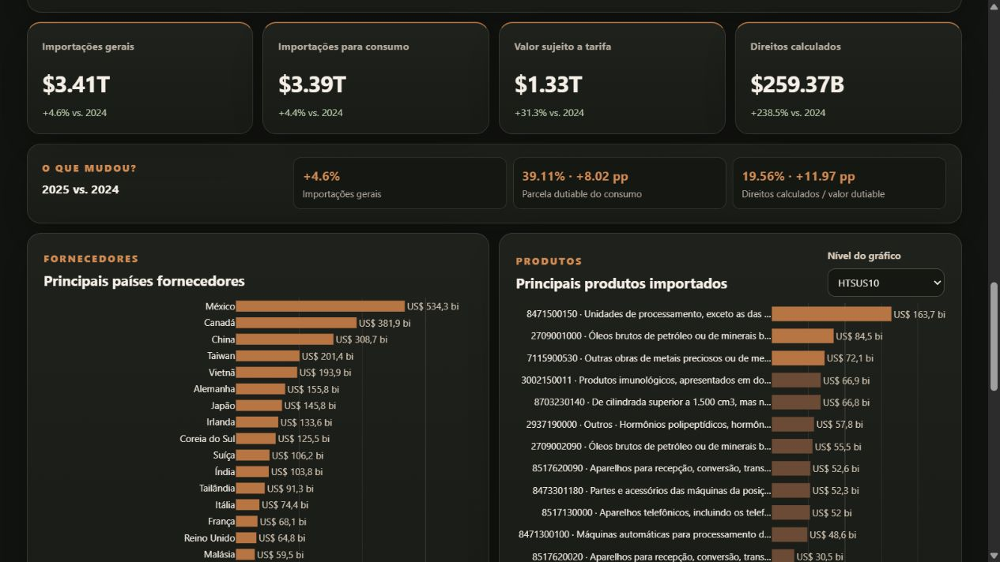
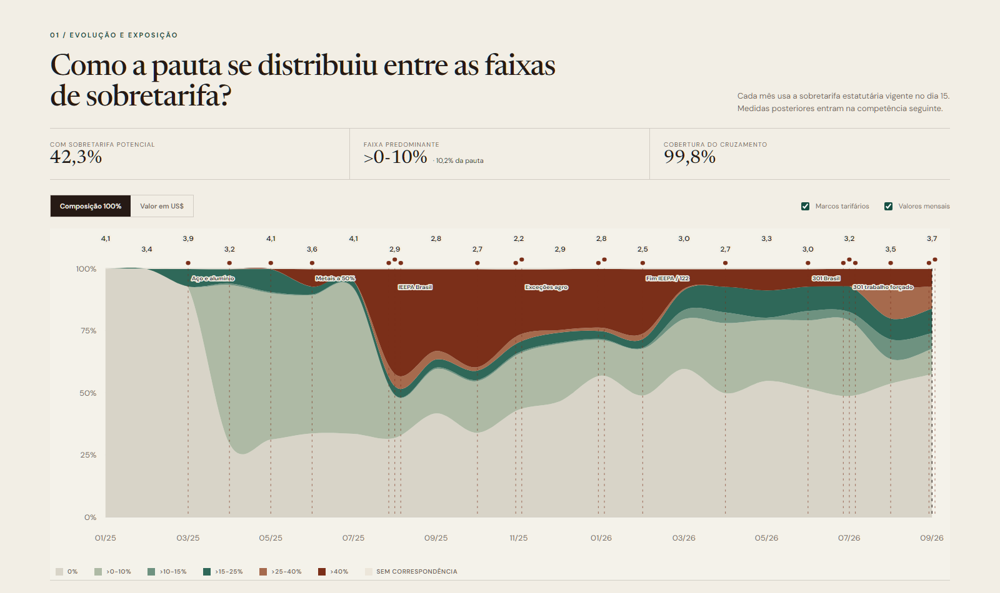

# Official Data API Toolkit

[English](README.md) | [Português](README.pt-BR.md)

A growing collection of practical connectors and code examples for accessing official national and international data APIs.

The idea is simple: many official databases are powerful, but the first query is often the hardest part. This repository keeps reusable examples in **Power Query M** and **Python**, with short notes explaining what each query is useful for.

Run the U.S. Census Python quickstart directly in Google Colab—no cloning or GitHub URL editing required.

## Available source modules

| Source | What you can query | Status |
|---|---|---|
| [U.S. Census International Trade API](sources/us-census/README.md) | U.S. imports and exports by product, partner country, port, classification and customs treatment | Available |
| [Yale Tariff Rate Tracker](sources/yale-tariff-rate-tracker/README.md) | U.S. statutory tariff rates by HTSUS10, origin country, authority and validity interval | Available |
| [Brazilian Federal Revenue — NCM](sources/receita-ncm/README.md) | Official Portuguese HS2/HS4/HS6 descriptions from Sistema Classif | Available |

## Featured showcase

### U.S. Census Imports API Showcase

An interactive bilingual application built from the U.S. Census International Trade API. Explore 690,424 import records for 2024 and 2025, compare suppliers and products, and understand the difference between general imports, imports for consumption, dutiable value and calculated duties.

**[Open the live dashboard →](https://feliperamon123.github.io/united-states-census-imports-api-showcase/)** · [Explore the U.S. Census module](sources/us-census/README.md) · [Showcase repository](https://github.com/FelipeRamon123/united-states-census-imports-api-showcase)

## U.S. Census examples

The first module currently includes seven query patterns:

| # | Query | Best for |
|---|---|---|
| 01 | World by HTSUS10 | Total U.S. imports by detailed product |
| 02 | All supplier countries by HTSUS10 | Large country × product dataset, including the data used by the U.S. Imports Explorer |
| 03 | One country by port and HS6 | Port-of-entry and transport analysis |
| 04 | One country by SITC section | Broad sector view |
| 05 | One country by HTSUS10 and Rate Provision | Observed customs-treatment analysis |
| 06 | U.S. exports to one country by Schedule B10 | Destination-market analysis and domestic-versus-re-export split |
| 07 | Monthly imports from one country by HTSUS10 | Time series with values, quantities, dutiable value and calculated duties |

Go to the [U.S. Census module](sources/us-census/README.md) for setup instructions, API notes and examples.

## Related showcase

The **U.S. Census Imports API Showcase** is a separate GitHub Pages application built from example 02. The toolkit remains the source of reusable extraction code; the showcase demonstrates one concrete application and links back to the code, documentation and downloadable dataset.

Repository: `united-states-census-imports-api-showcase`

### Brazil × U.S. tariffs

The [Brazil × U.S. tariffs monitor](https://github.com/FelipeRamon123/us-brazil-tariff-monitor) is a bilingual interactive application joining monthly Census imports for consumption to Yale's HTSUS10 × country panel. Its primary monthly classification uses the statutory surcharge in force on day 15, while retaining the day-weighted rate only as an auxiliary dataset field.

**[Open the live dashboard →](https://feliperamon123.github.io/us-brazil-tariff-monitor/)** · [Showcase repository](https://github.com/FelipeRamon123/us-brazil-tariff-monitor)

## Language and naming

To keep the repository useful for both international and Brazilian audiences:

- the default documentation is in English;
- Portuguese versions are provided when useful;
- **HTSUS10** is used for the 10-digit U.S. product classification;
- **Schedule B10** is used for 10-digit U.S. export reporting;
- **HS2 / HS4 / HS6** are used in English;
- **SH2 / SH4 / SH6** are used in Portuguese;
- **NCM** is used only when referring specifically to the Brazilian/Mercosur nomenclature.

See the [naming conventions](docs/NAMING_CONVENTIONS.md) for the distinction between HS, HTSUS and NCM levels.

## License

Code is available under the MIT License. Data remain subject to the terms and documentation of their original official sources.
