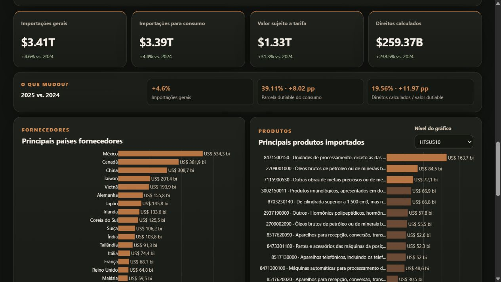
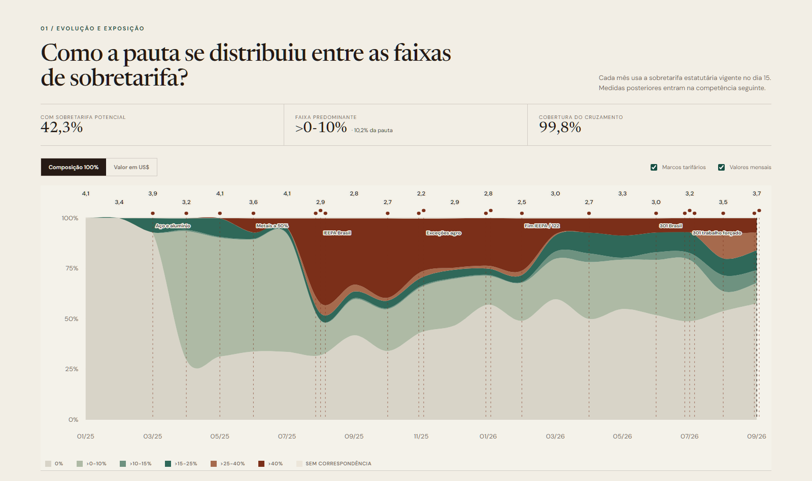

# Official Data API Toolkit

[English](README.md) | [Português](README.pt-BR.md)

Uma coleção em crescimento de conectores e códigos práticos para acessar APIs oficiais de dados nacionais e internacionais.

A ideia é simples: muitas bases oficiais são poderosas, mas a primeira consulta costuma ser a parte mais chata. Este repositório reúne exemplos reutilizáveis em **Power Query M** e **Python**, com explicações curtas sobre para que cada consulta serve.

Execute o início rápido em Python diretamente no Google Colab, sem clonar manualmente o repositório nem editar a URL do GitHub.

## Fontes disponíveis

| Fonte | O que dá para consultar | Status |
|---|---|---|
| [U.S. Census International Trade API](sources/us-census/README.pt-BR.md) | Importações e exportações dos EUA por produto, país parceiro, porto, classificação e tratamento aduaneiro | Disponível |
| [Yale Tariff Rate Tracker](sources/yale-tariff-rate-tracker/README.pt-BR.md) | Tarifas estatutárias dos EUA por HTSUS10, país de origem, autoridade e intervalo de vigência | Disponível |
| [Receita Federal — NCM](sources/receita-ncm/README.pt-BR.md) | Descrições oficiais em português nos níveis SH2/SH4/SH6 do Sistema Classif | Disponível |

## Showcase em destaque

### U.S. Census Imports API Showcase

Uma aplicação interativa e bilíngue construída com a U.S. Census International Trade API. Explore 690.424 registros de importações de 2024 e 2025, compare fornecedores e produtos e entenda as diferenças entre importações gerais, importações para consumo, valor sujeito a tarifa e direitos calculados.

**[Abrir o dashboard ao vivo →](https://feliperamon123.github.io/united-states-census-imports-api-showcase/)** · [Explorar o módulo do U.S. Census](sources/us-census/README.pt-BR.md) · [Repositório da showcase](https://github.com/FelipeRamon123/united-states-census-imports-api-showcase)

## Exemplos do U.S. Census

O primeiro módulo já traz sete padrões de consulta:

| # | Consulta | Serve para |
|---|---|---|
| 01 | Mundo por HTSUS10 | Total das importações dos EUA por produto detalhado |
| 02 | Todos os países fornecedores por HTSUS10 | Base grande País × Produto, incluindo a consulta usada no U.S. Imports Explorer |
| 03 | Um país por porto e SH6 | Análise de porto de entrada e transporte |
| 04 | Um país por seção SITC | Visão setorial ampla |
| 05 | Um país por HTSUS10 e Rate Provision | Análise do tratamento aduaneiro observado |
| 06 | Exportações dos EUA para um país por Schedule B10 | Análise de mercado de destino e separação entre exportações domésticas e reexportações |
| 07 | Importações mensais de um país por HTSUS10 | Série mensal com valores, quantidades, valor dutiável e direitos calculados |

Veja o [módulo do U.S. Census](sources/us-census/README.pt-BR.md) para instruções, conceitos da API e exemplos.

## Showcase relacionado

O **U.S. Census Imports API Showcase** fica em outro repositório e usa o GitHub Pages. O toolkit continua sendo a fonte dos códigos reutilizáveis; a showcase demonstra uma aplicação concreta e direciona para os códigos, a documentação e o dataset para download.

Repositório: `united-states-census-imports-api-showcase`

### Brasil × tarifas dos EUA

O [monitor Brasil × tarifas dos EUA](https://github.com/FelipeRamon123/us-brazil-tariff-monitor) é uma aplicação interativa bilíngue que cruza as importações mensais para consumo do Census com o painel HTSUS10 × país do Yale. A classificação mensal principal usa a sobretarifa vigente no dia 15, mantendo a média por dias apenas como campo auxiliar da base.

**[Abrir o dashboard →](https://feliperamon123.github.io/us-brazil-tariff-monitor/)** · [Repositório da showcase](https://github.com/FelipeRamon123/us-brazil-tariff-monitor)

## Idioma e nomenclatura

Para manter o material útil para público brasileiro e internacional:

- a documentação principal fica em inglês;
- versões em português são incluídas quando fazem sentido;
- **HTSUS10** é o nome usado para o código americano de 10 dígitos;
- **Schedule B10** é usado para o registro americano de exportações em 10 dígitos;
- **HS2 / HS4 / HS6** são usados em inglês;
- **SH2 / SH4 / SH6** são usados em português;
- **NCM** é usada apenas quando estamos falando especificamente da nomenclatura brasileira/Mercosul.

Consulte as [convenções de nomenclatura](docs/NAMING_CONVENTIONS.md) para entender a distinção entre os níveis HS, HTSUS e NCM.

## Licença

Os códigos estão sob licença MIT. Os dados continuam sujeitos aos termos e à documentação das fontes oficiais de origem.
