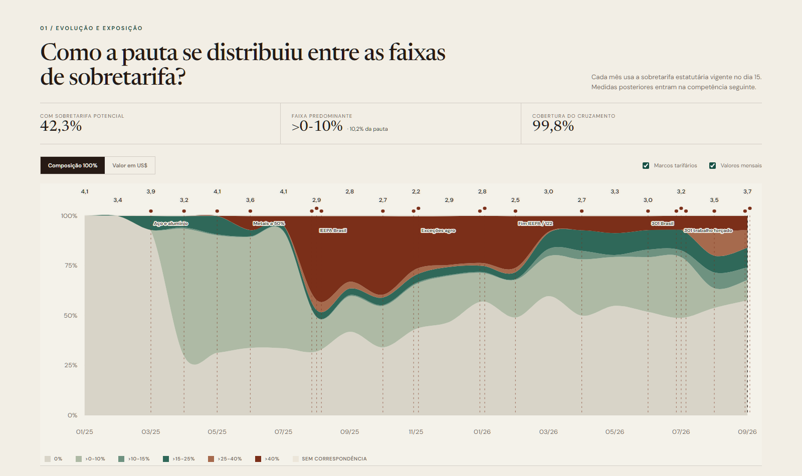

# Yale Tariff Rate Tracker

[English](README.md) | [Português](README.pt-BR.md)

Reusable access module for The Budget Lab at Yale's [Tariff Rate Tracker](https://github.com/Budget-Lab-Yale/tariff-rate-tracker). The project models U.S. statutory tariffs at the **HTSUS10 × origin country × validity interval** level.

## What this module provides

- latest-release resolution through the GitHub API;
- auditable ZIP download with tag, date, URL and size metadata;
- extraction from the `actual` panel only, excluding counterfactual scenarios;
- country filtering before Parquet-to-pandas conversion;
- compact CSV.GZ output ready to join to monthly Census trade data;
- a Power Query example that retrieves release metadata without loading the large archive into Excel.

## Examples

| # | Example | Use |
|---|---|---|
| 01 | [Download latest release](python/01_download_latest_release.py) | Resolves and downloads the official ZIP; writes a JSON manifest |
| 02 | [Extract one country panel](python/02_extract_country_rates.py) | Filters `actual/snapshots` by Census country code and writes CSV.GZ |
| 03 | [Build monthly surcharge exposure](python/03_build_monthly_tariff_exposure.py) | Joins Census example 07 to the Yale rate in force on day 15; retains a day-weighted auxiliary field |
| 01-M | [Release metadata in Power Query](power-query/01_latest_release_metadata.m) | Returns the official tag, date and asset URL |

## Quick start

```bash
python -m pip install -r requirements.txt
python sources/yale-tariff-rate-tracker/python/01_download_latest_release.py
python sources/yale-tariff-rate-tracker/python/02_extract_country_rates.py --country 3510
```

Country code `3510` identifies Brazil in the Census country classification used by the tracker.

## Joining to Census data

Census trade data are monthly; Yale rates are interval-based. For each `month × HTSUS10`, the primary field is `total_additional` in force on day 15. Measures beginning through day 15 enter that month; later measures enter the following month. `additional_rate_day_weighted` is retained only as an auxiliary field and does not determine the dashboard bands. This is modeled statutory surcharge exposure, not collected duties, and excludes base tariffs, antidumping, countervailing duties and measures outside the tracker.

## Limitations

- Yale rates are modeled statutory rates, not customs revenue records.
- Releases may include future intervals already encoded in the tracker schedule; always retain the release tag and publication date.
- The ZIP is large. Python/Parquet is the recommended extraction path; Power Query is intended for release discovery and processed extracts.

## Related showcase

[](https://feliperamon123.github.io/us-brazil-tariff-monitor/)

The [Brazil × U.S. tariffs dashboard](https://github.com/FelipeRamon123/us-brazil-tariff-monitor) applies this module to monthly imports from Brazil.
