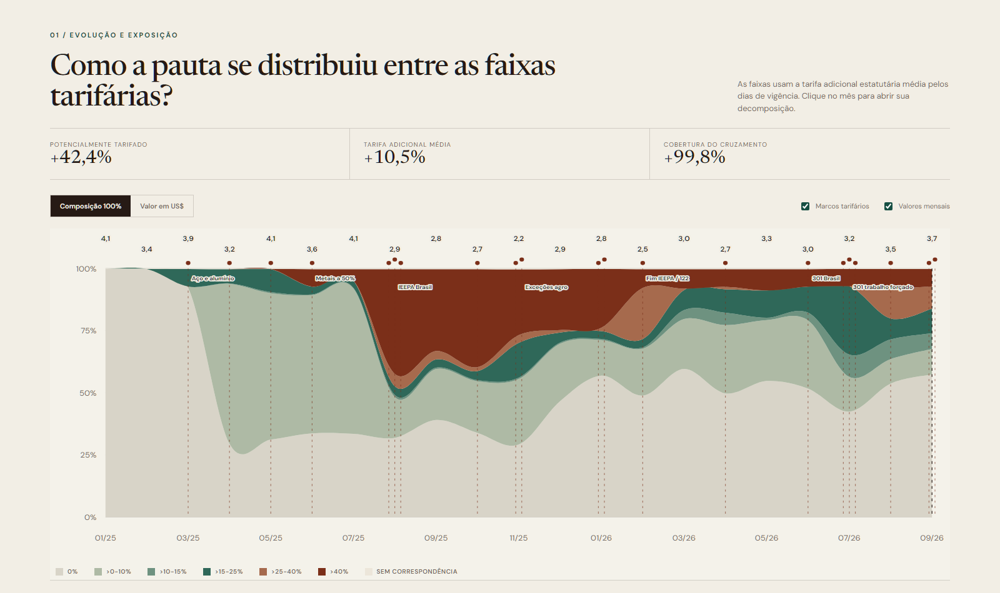

# Yale Tariff Rate Tracker

[English](README.md) | [Português](README.pt-BR.md)

Módulo reutilizável para acessar os releases do [Tariff Rate Tracker](https://github.com/Budget-Lab-Yale/tariff-rate-tracker), do The Budget Lab at Yale. O projeto modela tarifas estatutárias dos Estados Unidos no nível **HTSUS10 × país de origem × intervalo de vigência**.

## O que este módulo entrega

- resolução automática do release mais recente pela API do GitHub;
- download auditável do ativo ZIP, com tag, data, URL e tamanho registrados;
- leitura somente do painel `actual`, sem misturar cenários contrafactuais;
- filtro por país antes da conversão do Parquet para pandas;
- saída compacta em CSV.GZ pronta para cruzamento com dados mensais do Census;
- exemplo Power Query para consultar os metadados do release sem baixar o arquivo de centenas de megabytes no Excel.

## Exemplos

| # | Exemplo | Uso |
|---|---|---|
| 01 | [Baixar o release mais recente](python/01_download_latest_release.py) | Resolve e baixa o ZIP oficial; grava um manifesto JSON |
| 02 | [Extrair o painel de um país](python/02_extract_country_rates.py) | Filtra `actual/snapshots` por código Census do país e gera CSV.GZ |
| 03 | [Construir a exposição tarifária mensal](python/03_build_monthly_tariff_exposure.py) | Cruza o exemplo Census 07 com taxas Yale ponderadas pelos dias de vigência |
| 01-M | [Metadados do release em Power Query](power-query/01_latest_release_metadata.m) | Retorna tag, data e URL do ativo oficial |

## Uso rápido

```bash
python -m pip install -r requirements.txt
python sources/yale-tariff-rate-tracker/python/01_download_latest_release.py
python sources/yale-tariff-rate-tracker/python/02_extract_country_rates.py --country 3510
python sources/yale-tariff-rate-tracker/python/03_build_monthly_tariff_exposure.py --census data/monthly_imports_country_htsus10.csv.gz --yale data/yale-tariff-rate-tracker/country_3510_rates.csv.gz
```

O código `3510` representa o Brasil na classificação de países do Census usada pelo tracker.

## Regra de cruzamento com o Census

O Census é mensal, enquanto o Yale registra intervalos diários. Para cada `mês × HTSUS10`:

1. selecione os intervalos que intersectam o mês;
2. conte os dias de interseção;
3. calcule a média de `total_additional` ponderada pelos dias;
4. associe a taxa ao valor mensal de importações para consumo (`CON_VAL_MO`);
5. calcule médias da pauta ponderadas pelo valor importado.

Uma medida vigente desde 18 de agosto não deve ser aplicada retroativamente aos primeiros 17 dias. O resultado é uma **exposição estatutária mensal modelada**, e não os direitos efetivamente arrecadados.

## Limites

- As taxas são modeladas pelo Yale, não dados de arrecadação aduaneira.
- Releases podem conter intervalos futuros já incorporados ao cronograma do tracker; registre sempre tag e data de publicação.
- O ZIP é grande. A extração em Python/Parquet é a rota recomendada; o Power Query fica restrito à descoberta do release e ao consumo de extratos processados.

## Showcase relacionado

[](https://feliperamon123.github.io/us-brazil-tariff-monitor/)

O dashboard [Brasil × tarifas dos EUA](https://github.com/FelipeRamon123/us-brazil-tariff-monitor) aplica este módulo às importações mensais provenientes do Brasil.
